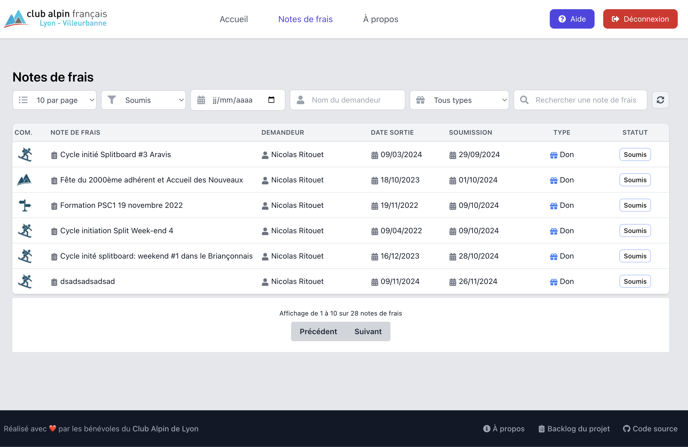

# Outil de Compta du Club Alpin de Lyon

Cette application permet aux gestionnaires des notes de frais du Club Alpin de Lyon de les traiter : approbation, refus et comptabilisation. Elle est réservée aux administrateurs et aux gestionnaires des notes de frais.
Les notes de frais sont soumises sur le site web du Club Alpin de Lyon : notes de sortie par les encadrants, et [notes hors sortie](#-notes-hors-sortie) (formation, achat). Une note hors sortie est d'abord validée sur le site par le responsable de sa commission, s'il y en a un, puis arrive dans compta-club. La trésorerie fait tout ici : le site n'a aucune fonction de trésorerie.

> ⚠️ **Note importante** :
> - Cette application s'appuie sur [l'API du site web du Club Alpin de Lyon](https://www.clubalpinlyon.fr/api) pour récupérer les données et gérer l'authentification.
> - Pour plus de détails sur les endpoints et leur usage, consultez la [documentation de l'API](./API.md).



## **✨ Fonctionnalités principales**

- 👀 Visualisation des notes de frais, avec filtres et recherche : par défaut « À valider » (soumises, ou validées par le responsable), filtre par type (sorties, formations, achats) ; la recherche et la date portent sur les sorties.
- ✅ Approbation, refus et comptabilisation des notes de frais par les gestionnaires.
- 🧾 [Notes hors sortie](#-notes-hors-sortie) (formations, achats), après la validation du responsable de commission : liste, page d'une note avec ses justificatifs et ses actions, PDF.
- 📜 Visualisation de l'historique des frais.
- 📄 Export PDF des notes approuvées ou comptabilisées, depuis la liste ou la page de la note : un modèle pour les notes de sortie, un autre pour les notes hors sortie.

## **🧾 Notes hors sortie**

Une note hors sortie rembourse une formation ou un achat fait pour le club, sans sortie. Elle passe par deux validations :

1. le responsable de sa commission la valide ou la refuse, sur le site : elle devient « Validée par le responsable » (`preapproved`) ;
2. la trésorerie l'approuve ou la refuse ici, puis la comptabilise.

Les valideurs d'une note sont les responsables de sa commission, sauf le demandeur et ceux qui sont supprimés, doivent renouveler leur adhésion, ont un compte verrouillé ou n'ont pas d'adresse mail. Une note sans valideur arrive directement ici, « Soumise » : la liste l'annonce « Directement à la trésorerie ». Une note encore chez son responsable n'apparaît pas dans la liste. Les valideurs sont recalculés à chaque lecture : si un responsable redevient actif (renouvellement, nomination) avant la décision de la trésorerie, la note quitte la liste et attend la sienne, sans que personne soit prévenu par mail ; une approbation depuis une page restée ouverte reçoit alors « Cette note attend encore la décision du responsable de la commission. » Un refus porte toujours un message ; corrigée, la note repasse par le responsable, s'il y en a un.

- Liste : « À valider » montre les notes soumises et celles validées par le responsable ; le filtre par type sépare sorties, formations et achats ; la recherche et la date ne portent que sur les sorties. Le montant d'une note hors sortie est le total déclaré, figé à l'envoi par la plateforme, avec « dont X € remb. » quand le remboursable est plus bas (« dont X € dans les plafonds » pour un don). Sous l'objet d'une note refusée, qui l'a refusée (« Refusée par la trésorerie le JJ/MM » ou par le responsable de commission) ; une note corrigée qui revient directement à la trésorerie porte « renvoyée après un refus ». Revalidée par son responsable, elle ne rappelle plus le refus, même celui de la trésorerie, ni dans la liste ni sur sa page : la plateforme n'expose que la dernière décision.
- Page d'une note (`/note-de-frais/note/{id}`) : type, commission et demandeur, objet, refus et avertissements, montant à payer ou don, libellé comptable, les actions Approuver, Refuser (message au demandeur obligatoire) et Comptabiliser ; puis date, validation du responsable, dépenses et justificatifs, totaux.
- PDF : son propre modèle, depuis la liste ou la page, une fois la note approuvée.

Les décisions de la trésorerie sont signées « la trésorerie », ici comme sur le site et dans les mails au demandeur. Le détail est dans [API.md](./API.md#page-dune-note-hors-sortie).

## **🚀 Prérequis**

Avant de commencer, assurez-vous d'avoir les outils suivants installés sur votre machine :
- **Node.js** 24.x (fixée dans `engines` du `package.json`, utilisée par Vercel et la CI)
- **pnpm**
- Un accès fonctionnel à l'API backend du site web du Club Alpin de Lyon.

## **⚙️ Installation**

### **💻 En local**

1. Clonez ce dépôt :
   ```bash
   git clone https://github.com/Club-Alpin-Lyon-Villeurbanne/compta-club.git
   cd compta-club
   ```

2. Installez les dépendances :
   ```bash
   pnpm install
   ```

3. Configurez les variables d'environnement en créant un fichier `.env.local` à la racine du projet à partir de `.env.exemple` :
   ```bash
   cp .env.exemple .env.local
   ```
   
   Puis modifiez `.env.local` selon vos besoins :
   ```env
   NEXT_PUBLIC_API_URL=http://localhost:8000/api  # préprod : https://www.clubalpinlyon.top/api
   NEXT_PUBLIC_CLUB_NAME="Nom de votre club"  # Optionnel, par défaut "CLUB ALPIN DE LYON"
   ```

   > 💡 **Astuce :** Assurez-vous que l'API backend est opérationnelle à l'URL spécifiée dans `NEXT_PUBLIC_API_URL`.

4. Lancez le serveur de développement :
   ```bash
   pnpm dev
   ```

5. Accédez à l'application à l'adresse suivante :  
   [http://localhost:3000](http://localhost:3000)

6. Connectez-vous avec un compte administrateur ou gestionnaire des notes de frais du backend utilisé : en local, le compte admin décrit dans la [documentation d'installation du site](https://github.com/Club-Alpin-Lyon-Villeurbanne/plateforme-club-alpin/blob/main/docs/installation.md) ; sur la préprod, votre compte sur [l'environnement de test du site web du Club Alpin de Lyon](https://www.clubalpinlyon.top/).

### **🚀 Déploiement sur Vercel**

Le déploiement se fait sur vercel automatiquement lorsque des modifications sont poussées sur la branche `main`. Vérifiez que le projets build correctement en lancant `pnpm build` et en vérifiant que le build se passe sans erreur.

Quand l'API change, compta-club se déploie d'abord, après vérification contre la préprod : chaque version de compta-club marche avec l'API en production comme avec celle qui la remplace.

Une fois la plateforme déployée avec les notes hors sortie, on ne revient pas à une compta-club d'avant elles, dont la liste plante sur un achat sans sortie : on corrige en avant. Le jour même, rechargez compta-club après le déploiement de la plateforme, pour qu'aucun onglet ne garde l'ancienne version.

## **🤝 Contribution**

Nous accueillons volontiers les contributions ! Voici comment vous pouvez aider :

### **📝 Processus de contribution**

1. **Forkez** ce dépôt.
2. Créez une nouvelle branche pour votre fonctionnalité ou correction :
   ```bash
   git checkout -b feature/ma-nouvelle-fonctionnalite
   ```
3. Faites vos modifications et testez-les localement.
4. Commitez vos changements avec un message clair :
   ```bash
   git commit -m "Ajout : nouvelle fonctionnalité pour X"
   ```
5. Poussez votre branche vers votre dépôt forké :
   ```bash
   git push origin feature/ma-nouvelle-fonctionnalite
   ```
6. Ouvrez une **pull request** depuis GitHub.

### **📋 Conventions**

- Respectez les bonnes pratiques de code.
- Assurez-vous que vos modifications passent tous les tests existants.
- Suivez les conventions de nommage des branches (`feature/`, `fix/`, etc.).

## **🧪 Tests**

### **Tests unitaires avec Vitest**

```bash
# Lancer les tests unitaires
pnpm test:unit

# Mode watch (relance automatique)
pnpm test:unit:watch
```

Les tests unitaires couvrent :
- Routes API (auth, expense-reports)
- Utilitaires fetch (client/serveur)
- Fonctions d'authentification, et retour à la page quittée après la connexion (chemin de retour contrôlé)
- Helpers et store Zustand
- Liste des notes de frais (notes de sortie et hors sortie, filtres)
- Page d'une note hors sortie (affichage, actions) et routes proxy (identifiant invalide, refus de l'API transmis sans détail technique)
- PDF d'une note hors sortie (contenu, montants figés, nom du fichier)

### **Tests E2E avec Playwright**

Les tests end-to-end sont implémentés avec Playwright. Ils n'ont besoin ni du backend ni d'identifiants : Playwright construit l'application en mode production, la sert sur le port 3100 et la branche sur un faux backend (`tests/mocks/fake-backend.ts`, données dans `tests/mocks/fixtures.ts`) qui reproduit les formats de l'API de production. Les notes hors sortie ne sont servies qu'aux tests qui les demandent (`login(page, { notesHorsSortie: true })`) : les tests des notes de sortie gardent leurs données. Le faux backend sert aussi une note par son identifiant et refuse les décisions comme la plateforme (« Cette note a déjà été traitée. », message obligatoire au refus d'une note hors sortie). Le test de largeur de la liste (`tests/list-width.spec.ts`) rend au Chromium de test la barre de défilement classique de Windows. Le build écrase `.next` : ne lancez pas `pnpm dev` en même temps. Avec la variable `PDF_SAMPLES_DIR` (un dossier existant), les tests y copient les PDF qu'ils téléchargent, pour les regarder.

1. Lancez les tests avec la commande :
   ```bash
   pnpm test:e2e
   ```

2. Pour lancer les tests avec l'interface utilisateur de Playwright :
   ```bash
   pnpm test:e2e:ui
   ```

Les tests E2E vérifient le flux d'authentification et d'autres fonctionnalités principales de l'application.

## **🏗️ Architecture technique**

### **🛠️ Technologies utilisées**
- **Frontend** : Next.js 15 (App Router)
- **Authentification** : JSON Web Tokens (JWT) via cookies httpOnly gérés par des routes API Next.js
- **Backend** : API du site web du Club Alpin de Lyon (https://www.clubalpinlyon.fr/api)
- **State Management** : Zustand
- **Styling** : Tailwind CSS + shadcn/ui
- **PDF Generation** : jsPDF + jspdf-autotable
- **Monitoring** : Sentry (production)

### **📁 Structure du projet**
- `/app` : Code source Next.js (App Router)
  - `/(public)`  : Pages accessibles sans authentification (home, à propos, aide)
  - `/(private)` : Pages protégées (gestion des notes de frais)
  - `/api`     : Routes API internes (auth, expense-reports)
  - `/components` : Composants spécifiques à l'application
  - `/lib`      : Utilitaires partagés (fetchClient, fetchServer, auth, constants)
  - `/store`    : Zustand store (état des filtres & pagination)
  - `/enums`, `/interfaces` : Types TypeScript (ExpenseReport, User, etc.)
  - `/utils`    : Utilitaires (helper, pdfGenerator pour les notes de sortie, noteHorsSortiePdf pour les notes hors sortie)
- `/components/ui` : Composants UI réutilisables (tables, formulaires...)  
- `/public`       : Assets statiques (images, favicon, etc.)
- `/tests`        : Tests (unit avec Vitest, E2E avec Playwright)

## **🔧 Scripts disponibles**

| Commande | Description |
|----------|-------------|
| `pnpm dev` | Serveur de développement |
| `pnpm build` | Build production |
| `pnpm start` | Serveur production |
| `pnpm lint` | Linter ESLint |
| `pnpm test:unit` | Tests unitaires (Vitest) |
| `pnpm test:e2e` | Tests E2E (Playwright) |

## **🤖 Outils de développement**

- **Claude Code** : Le fichier [CLAUDE.md](./CLAUDE.md) contient les instructions pour utiliser Claude Code sur ce projet.
- **CI/CD** : GitHub Actions exécute lint, tests unitaires et build sur chaque PR.
- **CodeRabbit** : Review automatique des PRs.
- **Vercel** : Déploiement automatique + preview sur chaque PR.

## **📬 Contact**

Pour toute question, suggestion ou problème, vous pouvez :
- 🐛 Ouvrir une issue sur [GitHub](https://github.com/Club-Alpin-Lyon-Villeurbanne/compta-club/issues).
- 📧 Contacter l'équipe via [numerique@clubalpinlyon.fr](mailto:numerique@clubalpinlyon.fr).

## **📄 Documentation complémentaire**

- [CLAUDE.md](./CLAUDE.md) - Instructions pour Claude Code
- [CONTRIBUTING.md](./CONTRIBUTING.md) - Guide de contribution détaillé
- [API.md](./API.md) - Endpoints API utilisés par cette application